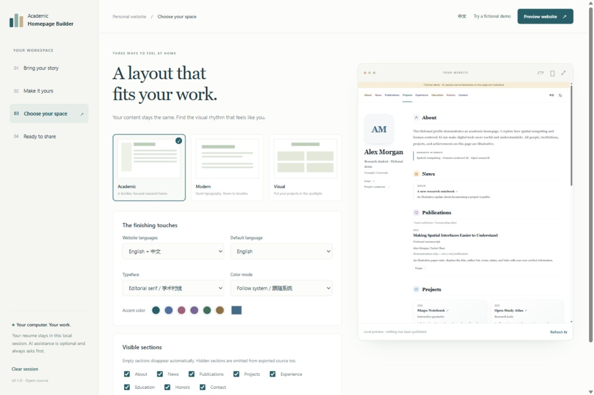
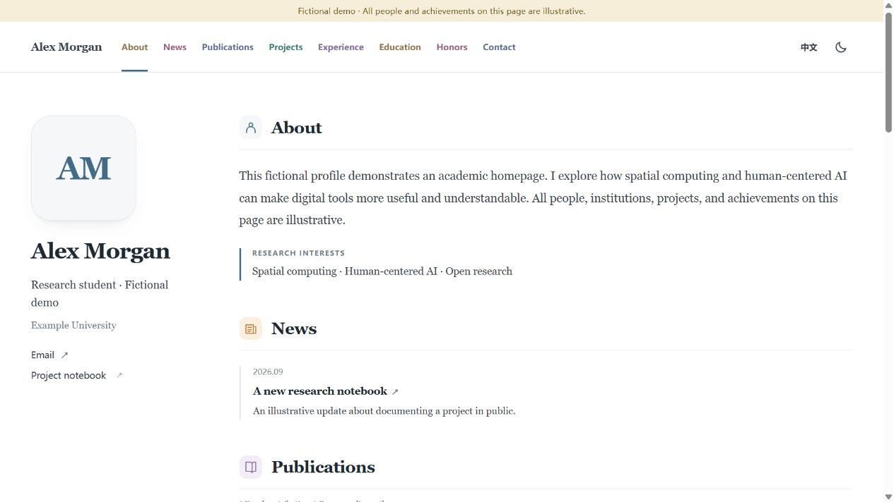
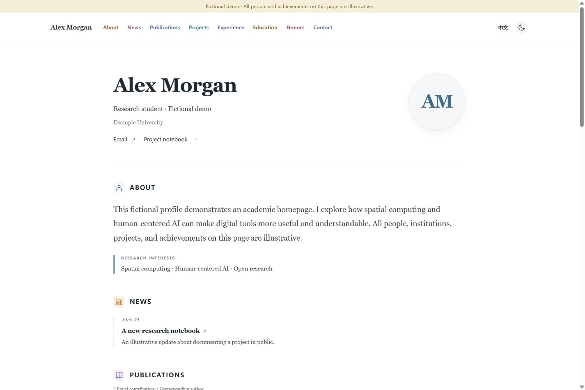
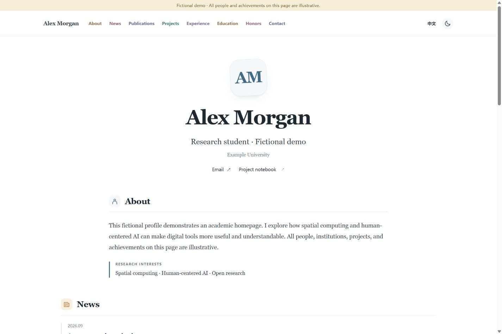

# Academic Homepage Builder

**Your CV, your computer, your academic homepage.**

A local web wizard for turning a résumé into a reviewed, portable academic
website. Choose **Academic**, **Modern**, or **Visual**, preview your content,
and export a static website or an editable source project.

[中文说明](README.zh-CN.md) · [Deployment](docs/deployment.md) ·
[Privacy](docs/privacy.md) · [Codex assistance](docs/codex.md) · [Validation](docs/validation.md)



| Academic | Modern | Visual |
| --- | --- | --- |
|  |  |  |

## What you get

- Local import of text-based PDF, DOCX, TXT, or pasted text.
- Editable biography, research interests, education, experience, papers,
  projects, honors, and contact details. Uncertain extraction stays unconfirmed.
- Three responsive templates, light/dark themes, section controls, and English,
  Chinese, or bilingual output.
- Explicit selection of public photos, figures, and optional CV attachments.
- Static ZIP and editable source ZIP exports; import the source project to update it later.
- Optional Codex assistance or a portable ChatGPT/Codex collaboration pack.
- A guided GitHub + Cloudflare Pages deployment path.

**One-click generation; guided first deployment.** You own the hosting accounts
and approve their authorizations. The builder does not register accounts or buy domains.

## Run locally

Install Python **3.12 or newer** and Git. After cloning or downloading the project,
the short startup path is:

- **Windows:** double-click `start.bat`, or run `.\start.bat` in PowerShell.
- **macOS / Linux:** run `sh start.sh` in the project directory.

These scripts create a local virtual environment, install the dependencies, and
open the wizard. Dependency installation can connect to the package index.
For a manual installation, run:

```sh
git clone https://github.com/masktrump19-sudo/academic-homepage-builder.git
cd academic-homepage-builder
python -m venv .venv
```

Activate the environment:

```powershell
# Windows PowerShell
.venv\Scripts\Activate.ps1
```

```sh
# macOS / Linux
source .venv/bin/activate
```

Then install and start:

```sh
python -m pip install -r requirements.txt
python -m pip install -e .
ahb serve
```

Open the local address printed by the command. The server listens only on
`127.0.0.1`. Installing dependencies needs internet access; the normal import,
edit, preview, and export flow does not. Node.js, an AI account, and an API key
are not needed for the basic builder.

## Build your homepage

1. **Import** your résumé, paste text, or load the fictional demo.
2. **Review** extracted information and remove anything you do not want to publish.
   Verify author order, dates, translations, and publication status yourself.
3. **Design** your page and select public assets. Empty sections are hidden.
4. **Preview** the languages and layouts, then confirm the public content list.
5. **Export** a static site or source project. Keep the source project for future updates.
6. **Deploy** through the [GitHub + Cloudflare guide](docs/deployment.md).

A scanned PDF has no usable text layer: paste its text or supply a text-based
file. OCR, cloud storage, and automatic academic fact verification are outside
the first release. Generated demo content is prominently marked as fictional.

## Optional AI

AI is **off by default**. Before a Codex request, you can inspect and edit the
exact text to send. The optional adapter uses your installed official Codex CLI
and its own login; this project does not copy credentials or offer model access.
ChatGPT subscriptions and API billing are different. Availability and usage
limits depend on your account.

If Codex is unavailable, export a collaboration pack, use it in your own
ChatGPT/Codex conversation, and import the resulting JSON. AI output is still
a draft until you review it. See [the AI workflow](docs/codex.md).

## CLI and maintenance

```sh
ahb build --project path/to/source-project --output path/to/site-output
ahb check path/to/site-output
```

An exported source project includes `site.json`, selected public assets, a
small build tool, and dependency requirements. It can be rebuilt with:

```sh
python -m pip install -r requirements.txt
python build.py
```

For a new paper or project, import the source project in the wizard, make your
changes, review, and export again. Push the updated source to your own repository;
Cloudflare Git integration can rebuild it automatically. Your URL can stay the same.

## Development

```sh
python -m pip install -r requirements.txt
python -m pip install -e ".[test]"
python -m pytest
python scripts/privacy_audit.py .
```

The privacy scanner examines publishable repository files and supplied ZIPs.
For a personal release audit, provide a private deny-list stored **outside**
the repository using `--deny-file`; see [release checks](docs/release.md).
Automated scans supplement human review; they cannot recognize every possible
piece of personal information in an image or document.

See [CONTRIBUTING.md](CONTRIBUTING.md) and [SECURITY.md](SECURITY.md).

## License and ownership

The software is [MIT licensed](LICENSE). Your content remains yours; you must
have permission to publish uploaded images and documents. Third-party licenses
and trademark boundaries are described in [THIRD_PARTY_NOTICES.md](THIRD_PARTY_NOTICES.md).
This is an independent community project, not an official OpenAI, GitHub, or
Cloudflare product.
