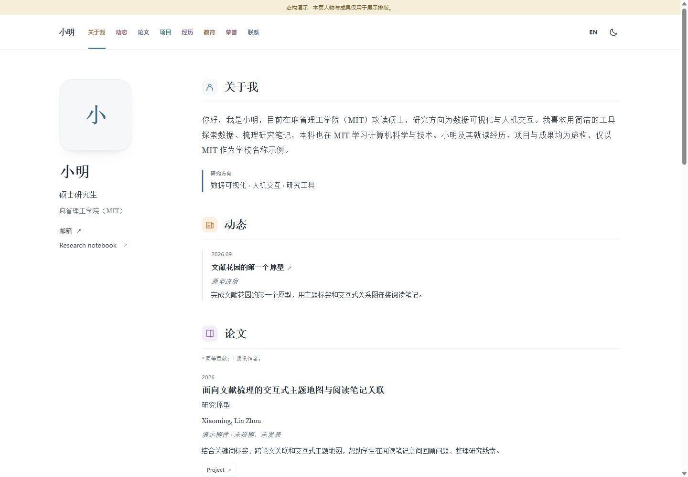
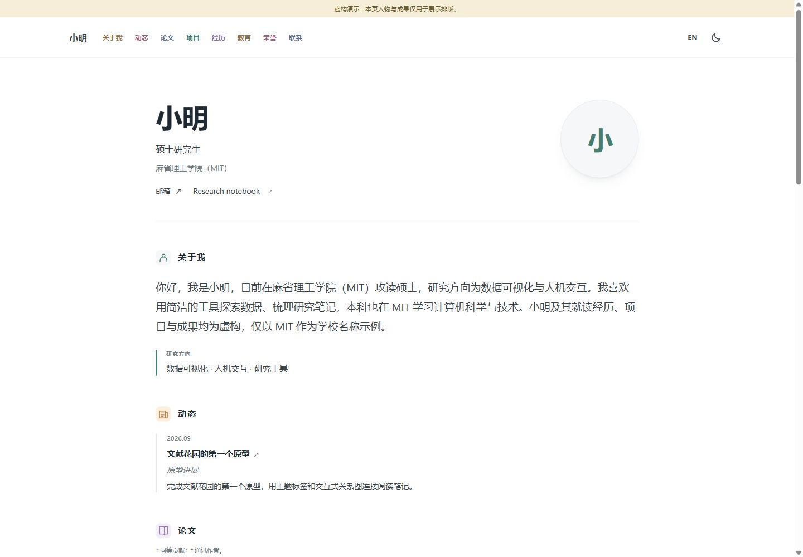
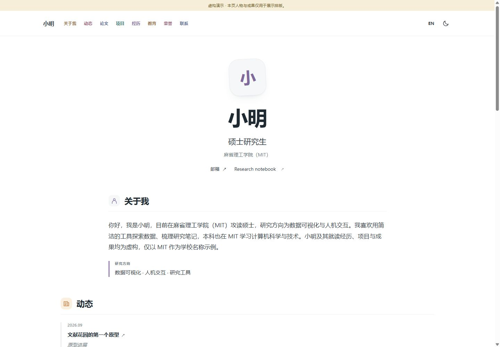

# Academic Homepage Builder

**简历留在本机，主页由你掌握。**

通过本地网页向导，把简历整理成个人学术主页：核对内容、选择模板、预览，
再导出静态网站或可维护的源码项目。

[English](README.md) · [部署教程](docs/deployment.md) ·
[隐私说明](docs/privacy.md) · [Codex 辅助](docs/codex.md) · [验证记录](docs/validation.md)

[查看在线模板演示](https://academic-homepage-builder.pages.dev/)。
在线演示仅展示虚构人物的静态主页；简历导入在本地向导进行。


## 中文主页展示

以下用虚构人物**“小明”**演示三套布局，以麻省理工学院（MIT）为学校名称示例；教育经历、项目与成果均为虚构，不代表实际关联。

### 学术双栏



| 现代简洁 | 视觉作品 |
| --- | --- |
|  |  |

查看中文模板：[学术双栏](https://academic-homepage-builder.pages.dev/academic/zh/) ·
[现代简洁](https://academic-homepage-builder.pages.dev/modern/zh/) ·
[视觉作品](https://academic-homepage-builder.pages.dev/visual/zh/)。
在线页面仅供查看静态示例，编辑与简历导入在本机进行。

## 功能

- 本机导入文字型 PDF、DOCX、TXT，也可以粘贴简历文字。
- 编辑简介、研究方向、教育、实习、论文、项目、荣誉和联系方式；不确定的信息保留为待确认。
- 学术双栏、现代简洁、视觉作品三套模板，支持手机、深浅色、栏目开关以及中文／英文／双语。
- 单独选择要公开的头像、配图和 CV，原始简历不随网站自动公开。
- 导出静态网站 ZIP 与源码 ZIP；以后导入源码项目即可继续修改。
- 可选 Codex 按钮和 ChatGPT／Codex 协作包。
- 引导连接自己的 GitHub 与 Cloudflare Pages。

这里的“一键”是**一键生成，首次上线由向导协助**。平台登录、仓库授权和域名设置
由使用者本人完成；本工具不代注册账号、不购买域名。

## 本地启动

安装 Python **3.12 或更高版本**和 Git。克隆或下载项目后，可以直接启动：

- **Windows：**双击 `start.bat`，或在 PowerShell 运行 `.\start.bat`。
- **macOS / Linux：**在项目目录运行 `sh start.sh`。

脚本会创建本地虚拟环境、安装依赖并打开向导；安装依赖时可能连接软件包下载源。
需要手动安装时，依次运行：

```sh
git clone https://github.com/masktrump19-sudo/academic-homepage-builder.git
cd academic-homepage-builder
python -m venv .venv
```

激活环境：

```powershell
# Windows PowerShell
.venv\Scripts\Activate.ps1
```

```sh
# macOS / Linux
source .venv/bin/activate
```

安装并启动：

```sh
python -m pip install -r requirements.txt
python -m pip install -e .
ahb serve
```

打开命令显示的本地网址即可。服务仅监听 `127.0.0.1`。首次安装依赖需要联网；
不启用 AI 和部署时，导入、编辑、预览、导出均在本机完成。
基础功能不需要 Node.js、模型账号或 API key。

## 从简历到主页

1. 导入简历、粘贴文字，或者加载明确标注的虚构演示资料。
2. 核对所有候选信息，删除不准备公开的内容。作者顺序、日期、译名和论文状态以本人确认为准。
3. 选择模板、语言、颜色和公开附件；没有内容的栏目不会显示。
4. 预览并确认公开内容清单，再导出静态网站或源码包。
5. 按[部署教程](docs/deployment.md)上线，保留源码包以便后续维护。

扫描版 PDF 无法直接提取文字，请改用文字型文件或粘贴文本。
首版不提供 OCR、云端简历存储或学术事实自动核验。

## 可选 AI 辅助

AI 默认关闭。调用前，你可以查看、删改真正要发送的文本。
Codex 按钮使用本机安装的官方 Codex CLI 及其登录状态；工具不读取或复制登录凭据，
也不提供模型账号。ChatGPT 订阅与 API 计费不同，具体可用性和额度取决于使用者账号。

没有安装 Codex 时，可以导出协作包，在自己的 ChatGPT／Codex 对话中处理后导回 JSON。
AI 结果仍是草稿，核对后才进入公开内容。[使用说明](docs/codex.md)

## 更新与命令行

```sh
ahb build --project path/to/source-project --output path/to/site-output
ahb check path/to/site-output
```

导出的源码包包含 `site.json`、明确选择的公开素材、构建工具及依赖文件：

```sh
python -m pip install -r requirements.txt
python build.py
```

以后有新的论文或项目，导入源码项目、更新内容、核对并重新导出，再推送到自己的仓库。
Cloudflare Git 集成可自动重新部署，无需更换网址。

## 参与开发

```sh
python -m pip install -r requirements.txt
python -m pip install -e ".[test]"
python -m pytest
python scripts/privacy_audit.py .
```

发布个人衍生版本前，可用 `--deny-file` 指定保存在仓库外的私人禁用词清单。
扫描不能代替人工检查，尤其不能保证识别图片或文件中的全部个人信息。
详见[发布检查](docs/release.md)、[贡献指南](CONTRIBUTING.md)和[安全说明](SECURITY.md)。

## 许可

代码采用 [MIT](LICENSE) 许可。使用者的内容归使用者所有；上传图片和文档需具有发布权限。
第三方依赖和品牌标识适用各自的许可与商标规则，见 [THIRD_PARTY_NOTICES.md](THIRD_PARTY_NOTICES.md)。
本项目由社区独立开发，并非 OpenAI、GitHub 或 Cloudflare 的官方产品。
